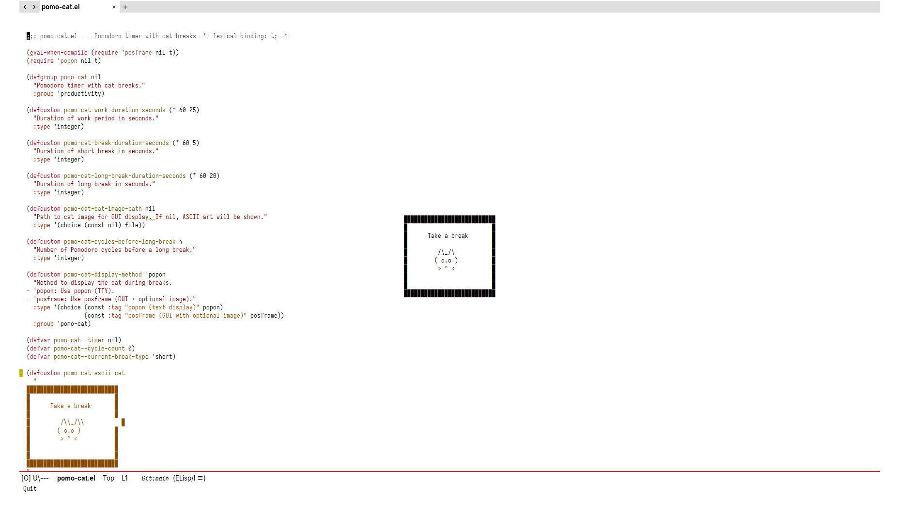
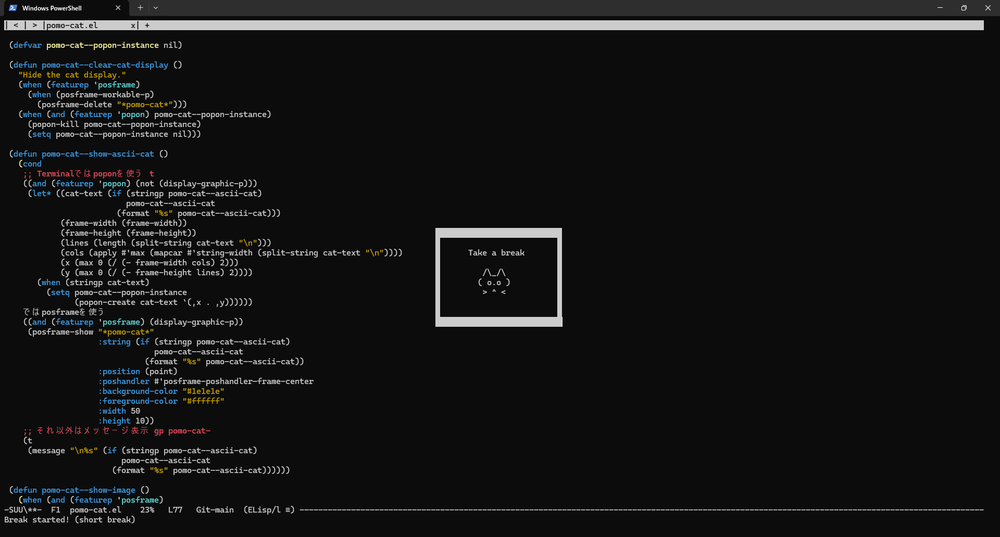
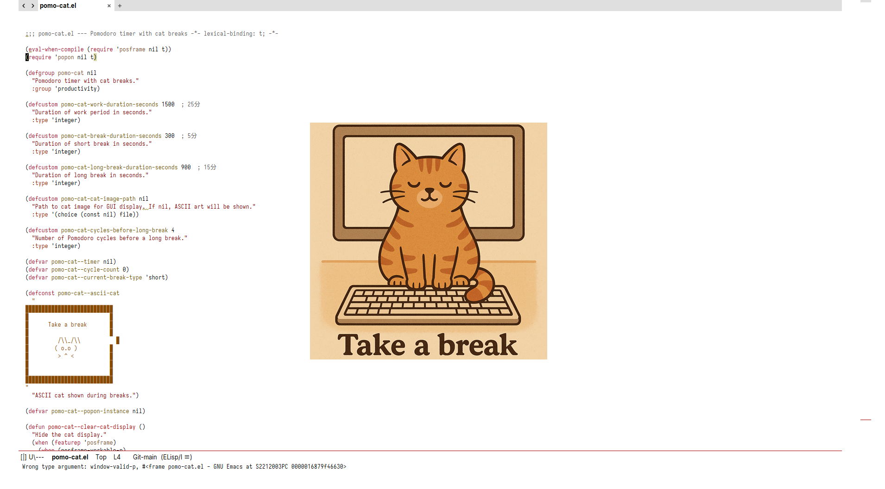
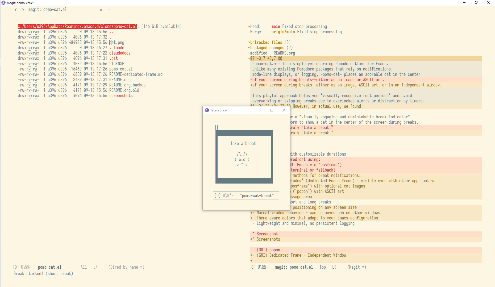

* Overview

=pomo-cat.el= is a simple yet charming Pomodoro timer for Emacs.
Unlike many existing Pomodoro packages that rely on notifications,
mode-line displays, or logging, =pomo-cat= places an adorable cat in the center
of your screen during breaks—either as an image, ASCII art, or in an independent window.

This playful approach helps you *visually recognize rest periods* and avoid
overworking or skipping breaks due to overlooked alerts or distraction by timers.

* Motivation

Most existing Pomodoro timers for Emacs focus on features like:

- Desktop or mode-line notifications
- Logging work/break times
- Progress indicators

However, in actual use, we found:

- Notifications are easy to miss—especially when deeply focused.
- Mode-line timers divert attention unnecessarily.
- Logs are rarely reviewed.

Hence, the need for a *visually engaging and unmistakable break indicator*.
This package was born to show a cat in the center of the screen during breaks,
reminding you to truly "take a break."

* Features

- Pomodoro timer with customizable durations
- Multiple display methods for break notifications:
  - *Independent window* (dedicated Emacs frame) - visible even with other apps active
  - GUI overlay (`posframe`) with optional cat images
  - Terminal popup (`popon`) with ASCII art
  - Fallback to message area
- Supports both short and long breaks
- Automatic center positioning on any screen size
- Normal window behavior - can be moved behind other windows
- Theme-aware colors that adapt to your Emacs configuration
- Lightweight and minimal, no persistent logging

* Screenshots

- (GUI) Posframe - Overlay Display

  

- (Terminal) Popon - Terminal Display

  

- (GUI) Posframe + Custom Image

  

- (GUI) Dedicated Frame - Independent Window

  

* Installation

The package is available on MELPA. Dependencies include ~posframe~ and ~popon~.

#+begin_src emacs-lisp
  (use-package pomo-cat
    :ensure t)
#+end_src

* Usage

** Quick Start

#+begin_src emacs-lisp
  ;; Option 1: Use dedicated frame (independent window, GUI only)
  (setq pomo-cat-use-dedicated-frame t)

  ;; Option 2: Use image with posframe (GUI only)
  (setq pomo-cat-use-dedicated-frame nil)
  (setq pomo-cat-cat-image-path
        (expand-file-name "cat.png"
                          (file-name-directory (locate-library "pomo-cat"))))

  ;; Option 3: Use ASCII art with popon (default, works in terminal)
  ;; No configuration needed

  ;; Start the timer
  M-x pomo-cat-start
#+end_src

** Commands

- `M-x pomo-cat-start` :: Start the Pomodoro timer
- `M-x pomo-cat-stop` :: Stop the timer and hide the cat
- `M-x pomo-cat-delay-break` :: Delay current break (during break periods)
- `M-x pomo-cat-stop-break` :: End current break immediately

** Display Methods Explained

The display method is automatically selected based on your configuration:

| ~pomo-cat-use-dedicated-frame~ | Image Path | GUI | Display Method       |
|--------------------------------+------------+-----+----------------------|
| t                              | -          | Yes | Dedicated Frame      |
| t                              | -          | No  | Popon (ASCII)        |
| nil                            | Set        | Yes | Posframe (Image)     |
| nil                            | Not set    | Yes | Posframe (ASCII)     |
| nil                            | Not set    | No  | Popon (ASCII)        |

*** Dedicated Frame

Creates an independent Emacs window that:
- Appears in the center of your screen
- Remains visible even when other applications are active
- Behaves like a normal window (can be moved behind others with Alt+Tab)
- Perfect for multi-monitor setups and full-screen applications
- Supports both images and ASCII art
- Uses only built-in Emacs functions (no external dependencies for frame itself)

*** Posframe (GUI)

Displays an overlay within Emacs (GUI only):
- Shows on top of your current Emacs session
- Used for both image and ASCII art display in GUI
- Requires the `posframe` package
- Best for single-monitor workflows

*** Popon (Terminal)

Shows a popup with ASCII art in terminal Emacs:
- Used when running Emacs in terminal (non-GUI)
- Requires the `popon` package

* Customization

Use =M-x customize-group RET pomo-cat RET= or set variables directly in your init file.

- `pomo-cat-work-duration-seconds` ::
  Duration of a single Pomodoro work session, in seconds.
  Default is 1500 seconds (25 minutes).
  You can set it to a shorter value for testing, e.g.:
  #+begin_src emacs-lisp
    (setq pomo-cat-work-duration-seconds 60) ;; 1 minute work session
  #+end_src

- `pomo-cat-break-duration-seconds` ::
  Duration of a short break after each work session, in seconds.
  Default is 300 seconds (5 minutes).
  These short breaks occur after each work cycle except the last one before a long break.

- `pomo-cat-long-break-duration-seconds` ::
  Duration of a long break (after multiple cycles), in seconds.
  Default is 1200 seconds (20 minutes).
  Useful for deeper rest after completing several Pomodoros.

- `pomo-cat-cycles-before-long-break` ::
  Number of completed Pomodoro cycles before a long break is triggered.
  Default is 4.
  For example, with the default setting:
  - You'll work 4 times for 25 minutes
  - Take 3 short breaks
  - And then take a long break after the 4th cycle

- `pomo-cat-cat-image-path` ::
  File path to a cat image (e.g., PNG) to display during breaks in GUI Emacs.
  If this is nil or the image doesn't exist, ASCII art will be shown instead.
  A sample image `cat.png` is bundled with this package.
  Example:
  #+begin_src emacs-lisp
    ;; Use bundled sample image
    (setq pomo-cat-cat-image-path
          (expand-file-name "cat.png"
                            (file-name-directory (locate-library "pomo-cat"))))

    ;; Or use your own image
    (setq pomo-cat-cat-image-path "~/Pictures/cats/cute-cat.png")
  #+end_src

- `pomo-cat-use-dedicated-frame` ::
  When non-nil and in GUI environment, displays break notification in a
  separate independent frame. When set to ~topmost~, the dedicated frame is
  requested to stay above normal windows (platform/window-manager dependent).
  When nil, uses posframe (if image is configured) or popon (ASCII art).
  Default is nil.

  #+begin_src emacs-lisp
    ;; Use dedicated frame (independent window)
    (setq pomo-cat-use-dedicated-frame t)

    ;; Use dedicated frame and request "always on top"
    (setq pomo-cat-use-dedicated-frame 'topmost)

    ;; Use posframe/popon based on image configuration (default)
    (setq pomo-cat-use-dedicated-frame nil)
  #+end_src

- `pomo-cat-dedicated-frame-position` ::
  Controls the position of the dedicated frame (GUI only).
  Supported values: ~center~, ~top-left~, ~top-right~, ~bottom-left~,
  ~bottom-right~. Default is ~center~.

  #+begin_src emacs-lisp
    ;; Show dedicated frame at bottom-right
    (setq pomo-cat-use-dedicated-frame t
          pomo-cat-dedicated-frame-position 'bottom-right)
  #+end_src

- `pomo-cat-dedicated-frame-margin-pixels` ::
  Margin (pixels) from screen edges for dedicated frame corner positions.
  Ignored when dedicated frame position is ~center~.

  #+begin_src emacs-lisp
    (setq pomo-cat-dedicated-frame-margin-pixels 24)
  #+end_src

- `pomo-cat-overlay-position` ::
  Controls the position of non-dedicated display modes (~posframe~ / ~popon~).
  Supported values: ~center~, ~top-left~, ~top-right~, ~bottom-left~,
  ~bottom-right~. Default is ~center~.

  #+begin_src emacs-lisp
    ;; For posframe/popon, place cat at bottom-right
    (setq pomo-cat-use-dedicated-frame nil
          pomo-cat-overlay-position 'bottom-right)
  #+end_src

- `pomo-cat-get-focus` ::
  Controls whether the break window receives focus when it appears.
  - `nil` (default) :: Window appears but doesn't steal focus (minimal interruption)
  - `t` :: Dedicated-frame mode focuses the break frame; other modes raise and focus the current Emacs frame

  #+begin_src emacs-lisp
    ;; Passive notification (default)
    (setq pomo-cat-get-focus nil)

    ;; Active notification (interrupts current work)
    (setq pomo-cat-get-focus t)
  #+end_src

- `pomo-cat-ascii-cat` ::
  A string of ASCII art to show when a cat image is not used or unavailable.
  You can replace it with your own ASCII art:
  #+begin_src emacs-lisp
    (setq pomo-cat-ascii-cat " (=^･ω･^=) Take a break!")
  #+end_src

* Dependencies

- [[https://codeberg.org/akib/emacs-popon][popon]] (for terminal popups)
- [[https://github.com/tumashu/posframe][posframe]] (for GUI popups)

*Note*: The dedicated frame feature requires no external dependencies—it uses only built-in Emacs functions.

* Advanced Usage

** Dedicated Frame Features

The dedicated frame mode offers the most robust break notification experience:

#+begin_src emacs-lisp
  ;; Enable dedicated frame with optimal settings
  (setq pomo-cat-use-dedicated-frame 'topmost
        pomo-cat-dedicated-frame-position 'bottom-right
        pomo-cat-dedicated-frame-margin-pixels 24
        pomo-cat-get-focus nil)  ; Non-intrusive notifications

  ;; Optionally use image in dedicated frame
  (setq pomo-cat-cat-image-path
        (expand-file-name "cat.png"
                          (file-name-directory (locate-library "pomo-cat"))))

  ;; The frame will:
  ;; - Appear at the configured screen position
  ;; - Be visible even with other apps active
  ;; - Allow normal window switching (Alt+Tab)
  ;; - Clean up automatically when break ends
#+end_src

** Multi-Monitor Support

The dedicated frame automatically adapts to your display configuration:
- Positions on your primary display using the configured anchor (center/corners)
- Respects taskbars and system UI
- Works with various screen resolutions
- Supports multi-monitor workflows

** Integration with Window Managers

Works seamlessly with different environments:
- Windows: Standard window controls and Alt+Tab
- macOS: Mission Control and Spaces compatibility
- Linux: GNOME, KDE, i3, and other window managers

* Troubleshooting

** Display Issues

If the cat doesn't appear as expected:

#+begin_src emacs-lisp
  ;; Check your current configuration
  (message "Use dedicated frame: %s" pomo-cat-use-dedicated-frame)
  (message "Image path: %s" pomo-cat-cat-image-path)
  (message "GUI environment: %s" (display-graphic-p))

  ;; Verify dependencies are available
  (message "Posframe available: %s" (featurep 'posframe))
  (message "Popon available: %s" (featurep 'popon))

  ;; Test dedicated frame (no dependencies needed for frame itself)
  (setq pomo-cat-use-dedicated-frame t)
#+end_src

** Dedicated Frame Position Notes

- Dedicated frame and overlay modes use different settings:
  - Dedicated frame :: ~pomo-cat-dedicated-frame-position~
  - Posframe/popon :: ~pomo-cat-overlay-position~
- On some Wayland environments (for example PGTK Emacs), the compositor may
  ignore window position requests for separate top-level frames. In that case,
  dedicated frames may still appear centered or compositor-managed even when
  ~pomo-cat-dedicated-frame-position~ is set.
- Posframe/popon positioning is inside the current Emacs frame/terminal, so it
  is usually not affected by the above Wayland limitation.
- Dedicated frame "always on top" (~pomo-cat-use-dedicated-frame~ = ~'topmost~)
  is also backend/window-manager dependent.

** Focus Problems

If windows behave unexpectedly:

#+begin_src emacs-lisp
  ;; Use passive notifications for minimal interruption
  (setq pomo-cat-get-focus nil)

  ;; Or enable active notifications if you prefer
  (setq pomo-cat-get-focus t)
#+end_src

* License

MIT License.
